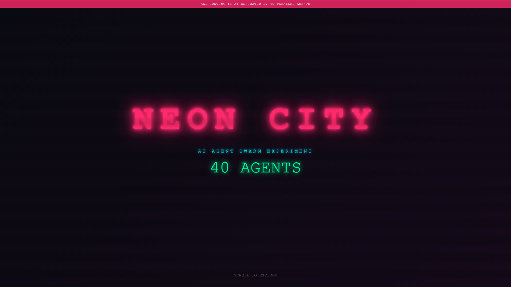
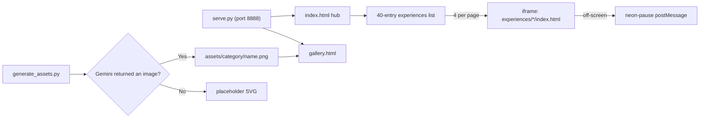

# Neon City

_Built in December 2025 and originally hosted in a private repository; published here as a single snapshot._

40 AI coding agents ran in parallel, and each one built a single interactive cyberpunk visual: boids, fluid, fractals, Game of Life, metaballs, Voronoi and more. `index.html` is the hub that embeds them, four at a time. `gallery.html` shows pixel-art assets generated with Gemini.



## How it works



The hub only knows each experience's folder name and loads them as iframes, four per page, telling off-screen ones to pause. How the agents were run is not recorded in this repo.

## Run

```sh
python3 serve.py        # opens http://localhost:8888
```

Each experience is one self-contained `experiences/<name>/index.html` with no build step.

## Regenerate assets

```sh
GEMINI_API_KEY=... python3 generate_assets.py
```
